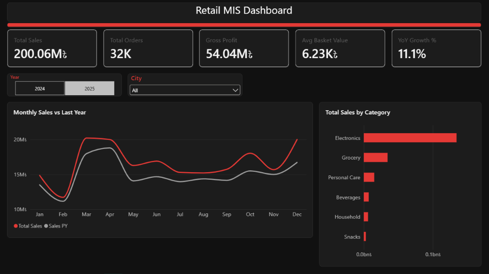
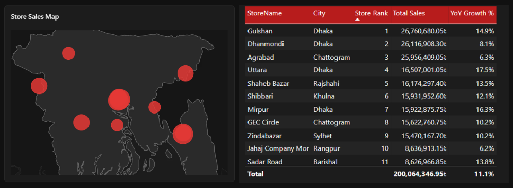
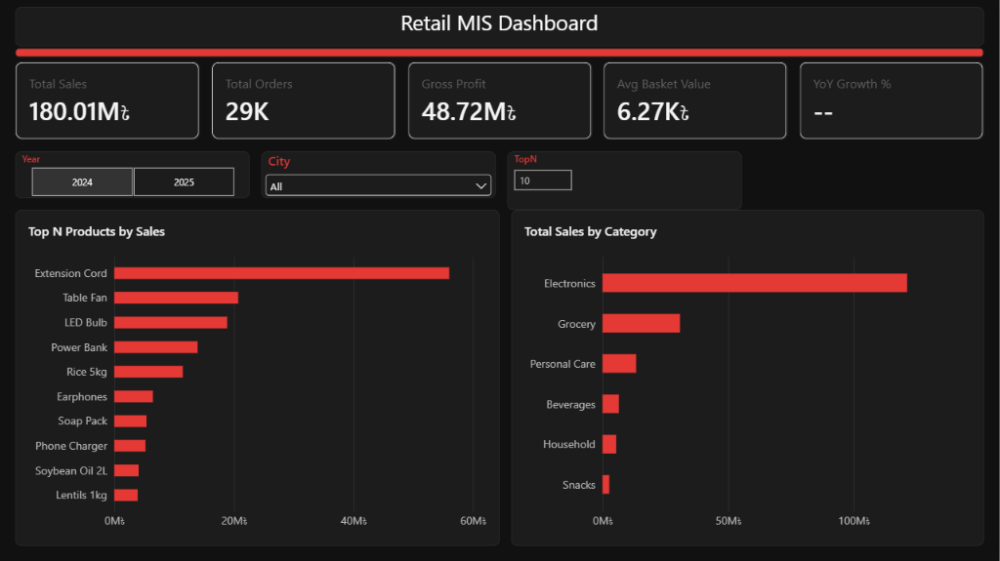

# Retail MIS Analytics Dashboard (Power BI)

An interactive management-information dashboard for a 12-store retail chain in Bangladesh, built in Power BI on a 5-table star schema with DAX measures for year-over-year growth, basket analysis, dynamic store ranking and Top-N product analysis.



## Highlights

- **5-table star schema** — one fact table (212K invoice lines) and four dimensions, many-to-one, single-direction filtering
- **DAX time intelligence** — `Sales PY` and `YoY Growth %` with `CALCULATE` + `SAMEPERIODLASTYEAR` on a marked date table
- **Basket analysis** — average basket value and size per invoice using `DISTINCTCOUNT`
- **Dynamic store ranking** — `RANKX` over `ALLSELECTED` that responds to Year and City slicers
- **Top-N products** — what-if parameter slider driving a rank-based visual filter
- **Store map without sign-in** — geo-scatter on latitude/longitude over a custom Bangladesh map background
- **Custom JSON theme** — consistent black-and-red styling across all pages

## Report pages

### 1. Overview
KPI cards (Total Sales, Total Orders, Gross Profit, Avg Basket Value, YoY Growth %), monthly sales against last year, and sales by category.

### 2. Stores
Store locations sized by sales, with a ranking table showing each store's sales and YoY growth.



### 3. Products
A slider controls how many top products are shown. Clicking a category bar re-ranks products within that category.



## Data model


| Table | Rows | Role |
|---|---|---|
| `Fact_Sales` | 212,274 | Invoice lines: date, store, customer, product, quantity, discount, sales, cost |
| `Dim_Date` | 731 | Calendar 2024–2025, marked as date table |
| `Dim_Store` | 12 | Store, city, type, latitude/longitude |
| `Dim_Product` | 38 | Product, category, brand, price, cost |
| `Dim_Customer` | 2,501 | Gender, age group, segment |

Full data dictionary: [docs/data_model.md](docs/data_model.md)

## Key DAX

All measures: [dax/measures.dax](dax/measures.dax)

```dax
YoY Growth % =
VAR CurrentSales  = [Total Sales]
VAR PreviousSales = [Sales PY]
RETURN
    DIVIDE ( CurrentSales - PreviousSales, PreviousSales )

Store Rank =
IF (
    HASONEVALUE ( Dim_Store[StoreName] ),
    RANKX ( ALLSELECTED ( Dim_Store ), [Total Sales], , DESC, DENSE )
)

Show Top N =
IF ( [Product Rank] <= [TopN Value], 1, 0 )
```

## Insights

- Sales grew **11.1%** year over year, from ৳180.0M (2024) to ৳200.1M (2025).
- Sales peak in **March–April** and dip in **February**.
- **Electronics** contributes about two-thirds of revenue because of its higher unit prices.
- In 2025, **Gulshan** leads revenue, while **Uttara (+17.5%)** and **Mirpur (+16.3%)** are growing fastest; **Agrabad**, third by revenue, grew only 6.3%.
- Average basket: **৳6,249** and **8.7 items** per order; gross margin **27%**.

## Problems solved

1. **Ranks resetting within each city.** The first `Store Rank` used `ALLSELECTED(Dim_Store[StoreName])`. With City on the table, the City filter stayed active and stores were ranked only against their own city. Applying `ALLSELECTED` to the whole `Dim_Store` table removed every store-attribute filter from the visual while keeping slicer selections.
2. **Map visual needed an organisational sign-in.** Azure Maps would not render without a work account, so the Stores page uses a scatter chart (Longitude × Latitude) with fixed axis bounds and a Bangladesh map image, rendered to the same bounds, as the plot-area background.
3. **Header not detected.** `Dim_Customer` has only text columns, so Power Query loaded the header as a data row. Fixed with *Use First Row as Headers* before building the relationship.
4. **Misleading YoY total.** At the grand-total level both years are in context, so YoY showed 111%. The dashboard keeps a single year selected through the Year slicer.

## Repository structure

```
├── Retail_MIS_Dashboard.pbix          Power BI report
├── data/                              Five CSV tables
├── dax/measures.dax                   All DAX measures
├── docs/
│   ├── data_model.md                  Relationships and data dictionary
│   └── build_guide.md                 Step-by-step build and validation
├── theme/Retail_MIS_BlackRed_Theme.json
├── assets/Bangladesh_Map_Background.png
├── scripts/generate_dataset.py        Reproduces the dataset (seeded)
└── screenshots/
```

## How to open

1. Install [Power BI Desktop](https://powerbi.microsoft.com/desktop/) (free, Windows).
2. Open `Retail_MIS_Dashboard.pbix`.
3. If the data does not load, go to **Transform data → Data source settings → Change Source** and point each source to the matching file in `data/`, then **Refresh**.

To regenerate the data: `pip install pandas numpy` then `python scripts/generate_dataset.py`.

## Dataset

The data is **synthetic**, generated with a seeded Python script to model a Bangladeshi retail chain (12 stores across 8 cities, 38 products in 6 categories, 2024–2025). It contains no real customer or company data.

## Tools

Power BI Desktop · Power Query · DAX · Python (pandas, NumPy) for data generation

## Author

**Minhaz Alam Jisan** — MIS / Data Analyst
[LinkedIn](https://www.linkedin.com/in/minhazjisan)
