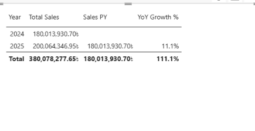

# Build Guide

How the dashboard was built, step by step, in Power BI Desktop.

## 1. Load and shape data (Power Query)

1. **Get Data → Text/CSV** for the five files in `data/` (UTF-8).
2. Set data types:
   - `Fact_Sales`: Date → Date, Quantity → Whole number, Discount → Decimal, SalesAmount/CostAmount → Fixed decimal
   - `Dim_Store`: Latitude/Longitude → Decimal, OpenDate → Date
   - `Dim_Date`: Date → Date, Year/MonthNo/WeekdayNo → Whole number
3. `Dim_Customer` has only text columns, so Power Query did not detect the header row. Fixed with **Use First Row as Headers**.

## 2. Model

1. Create the four many-to-one, single-direction relationships listed in [data_model.md](data_model.md).
2. **Mark `Dim_Date` as date table** on the `Date` column (required for `SAMEPERIODLASTYEAR`).
3. Sort `MonthName` by `MonthNo` and `Weekday` by `WeekdayNo`.
4. Set `Year`, `MonthNo`, `WeekdayNo`, `Latitude`, `Longitude` to **Don't summarize**; set Latitude/Longitude data categories.

## 3. Measures

1. **Modeling → New table**: `_Measures = ROW("Temp", BLANK())`, then hide `Temp`.
2. Create the measures in [`dax/measures.dax`](../dax/measures.dax) with `_Measures` as home table.
3. **Modeling → New parameter → Numeric range**: `TopN`, 5–20, step 1, default 10.

## 4. Report

1. **Design → Themes → Import theme** → `theme/Retail_MIS_BlackRed_Theme.json`.
2. Canvas 1280 × 720 (16:9). Three pages share a header text box, a red accent bar, five KPI cards and Year/City slicers.

| Page | Visuals |
|---|---|
| **Overview** | KPI cards · Monthly Sales vs Last Year (line: Total Sales, Sales PY by MonthName) · Total Sales by Category (bar) |
| **Stores** | Store Sales Map (scatter: Longitude × Latitude, size = Total Sales, Bangladesh map image as plot-area background) · Store ranking table (Store Rank, Total Sales, YoY Growth %) |
| **Products** | TopN slider · Top N Products by Sales (bar, visual filter `Show Top N = 1`) · Total Sales by Category (cross-filters the Top-N chart) |

### Map without sign-in

Azure Maps requires an organisational sign-in. Instead, the Stores page uses a **scatter chart** with Longitude on X (88.0–92.8) and Latitude on Y (20.6–26.7), and `assets/Bangladesh_Map_Background.png` — rendered to exactly those bounds — as the plot-area background with **Image fit: Fill**. Axis values, titles and gridlines are hidden.

## 5. Validation

| Check | Expected |
|---|---|
| Total Sales (all) | ৳380,078,277.65 |
| Total Orders | 60,820 |
| Gross Margin % | 27.0% |
| Avg Basket Value / Size | ৳6,249.23 / 8.73 items |
| Sales 2024 → 2025 | ৳180.01M → ৳200.06M (**YoY +11.1%**) |
| Store rank, all years | Agrabad #1 … Sadar Road #12 |
| Top product | Extension Cord |

