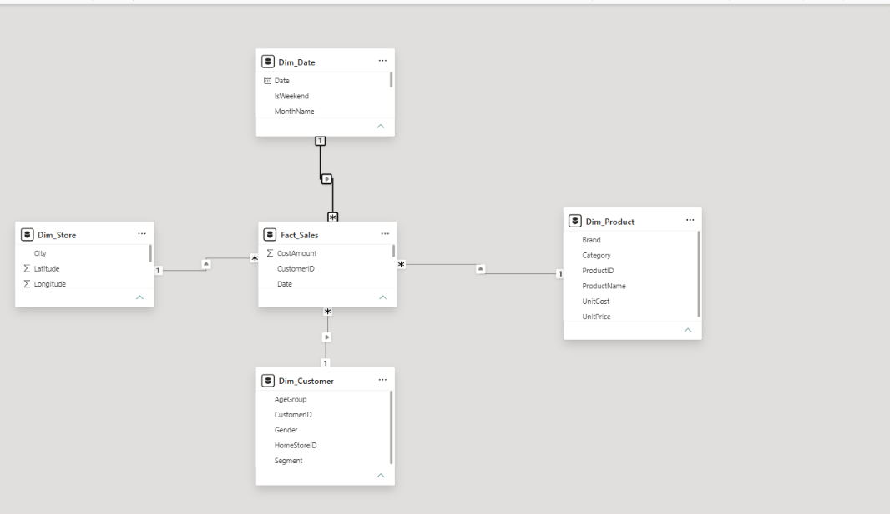

# Data Model & Data Dictionary

## Star schema

| Relationship | Cardinality | Cross-filter |
|---|---|---|
| `Fact_Sales[Date]` → `Dim_Date[Date]` | Many-to-one | Single |
| `Fact_Sales[StoreID]` → `Dim_Store[StoreID]` | Many-to-one | Single |
| `Fact_Sales[ProductID]` → `Dim_Product[ProductID]` | Many-to-one | Single |
| `Fact_Sales[CustomerID]` → `Dim_Customer[CustomerID]` | Many-to-one | Single |

Filters flow from each dimension to the fact table. `Dim_Customer[HomeStoreID]` is intentionally **not** related to `Dim_Store`, to avoid an ambiguous filter path.

## Tables

### Fact_Sales — 212,274 rows (one row per invoice line)

| Column | Type | Description |
|---|---|---|
| SalesID | Whole number | Surrogate key |
| InvoiceID | Text | Invoice (basket) number — one invoice has several lines |
| Date | Date | Transaction date (2024-01-01 to 2025-12-31) |
| StoreID | Text | FK → Dim_Store |
| CustomerID | Text | FK → Dim_Customer (`C00000` = walk-in) |
| ProductID | Text | FK → Dim_Product |
| Quantity | Whole number | Units sold |
| Discount | Decimal | 0, 0.05, 0.10 or 0.15 |
| SalesAmount | Fixed decimal | Quantity × UnitPrice × (1 − Discount) |
| CostAmount | Fixed decimal | Quantity × UnitCost |

### Dim_Store — 12 rows

| Column | Description |
|---|---|
| StoreID | Key |
| StoreName | Branch name (Gulshan, Agrabad, …) |
| City | Dhaka, Chattogram, Sylhet, Rajshahi, Khulna, Barishal, Rangpur, Cumilla |
| Latitude / Longitude | Store location — *Don't summarize*, Data category Latitude/Longitude |
| StoreType | Flagship, Standard, Express |
| OpenDate | Store opening date |

### Dim_Product — 38 rows

| Column | Description |
|---|---|
| ProductID | Key |
| ProductName | Product name |
| Category | Grocery, Beverages, Personal Care, Household, Snacks, Electronics |
| Brand | Brand |
| UnitPrice / UnitCost | Price and cost per unit (৳) |

### Dim_Customer — 2,501 rows

| Column | Description |
|---|---|
| CustomerID | Key (`C00000` = walk-in customer) |
| Gender, AgeGroup | Demographics |
| Segment | Walk-in, Regular, Member, Premium |
| HomeStoreID | Customer's usual store (not related in the model) |

### Dim_Date — 731 rows (marked as date table)

| Column | Notes |
|---|---|
| Date | Key, contiguous calendar 2024–2025 |
| Year, MonthNo, WeekdayNo | *Don't summarize* |
| MonthName | Sorted by `MonthNo` |
| Weekday | Sorted by `WeekdayNo` |
| YearMonth | Date type, custom format `yyyy-mm` |
| Quarter | Q1–Q4 |
| IsWeekend | Friday/Saturday = Yes (Bangladesh weekend) |

### _Measures and TopN

- `_Measures` — dummy table holding all DAX measures (see [`dax/measures.dax`](../dax/measures.dax)).
- `TopN` — what-if parameter table (5–20) that drives the Top-N slider.
